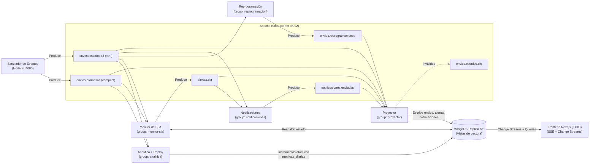

# RutaSur — Plataforma de Seguimiento Logístico Orientada a Eventos (TP7)

**Licenciatura en Sistemas de Información — Programación Avanzada (2026)**  
**Universidad Autónoma de Entre Ríos — Facultad de Ciencia y Tecnología (UADER — FCyT)**

---

## 1. Resumen e Hipótesis de Negocio

**RutaSur** es una plataforma de seguimiento de envíos de última milla en tiempo real construida de punta a punta bajo una **Arquitectura Orientada a Eventos (EDA)** y el patrón **CQRS** (separación entre el log de eventos de escritura y las vistas proyectadas de lectura).

* **Hipótesis:** Si cada cambio de estado de un envío se trata como un evento inmutable, la empresa puede intervenir durante la operación (reprogramar entregas fallidas en el acto, rescatar envíos antes de que incumplan el SLA y notificar al destinatario) en lugar de analizar fracasos al día siguiente mediante reportes batch nocturnos.
* **Stack Tecnológico:**
  * **Log de eventos:** Apache Kafka 3.7 en modo **KRaft** (sin ZooKeeper).
  * **Microservicios:** 5 servicios consumidores independientes + 1 simulador en **Node.js** (`kafkajs`, `mongoose`, `node-cron`, `express`).
  * **Modelo de lectura (CQRS):** **MongoDB 7.0** configurado como **Replica Set (`rs0`)** para habilitar *Change Streams*.
  * **Interfaz Web en Tiempo Real:** **Next.js (App Router)** con **Server-Sent Events (SSE)** alimentados por los *Change Streams* de MongoDB.
  * **Inspección de Broker:** **Kafdrop** (`http://localhost:9000`).

---

## 2. Arquitectura del Sistema

**Regla de oro de desacople:** Kafka es el único punto de contacto entre los servicios; ningún servicio consumidor llama a otro en forma directa. MongoDB almacena únicamente vistas derivadas (que pueden borrarse y reconstruirse leyendo Kafka desde el offset `0`) y Next.js solo lee de MongoDB.



### Componentes y Grupos de Consumidores

| Componente | Grupo de Consumidores | Responsabilidad |
| :--- | :--- | :--- |
| **Simulador** (`services/simulador`) | No consume | Genera el flujo continuo (20 envíos/min), reloj simulado acelerado (`1h = 30s`), corrida con semilla fija (`Mulberry32`) y escenarios de demo. |
| **Proyector** (`services/proyector`) | `proyector` | Mantiene las vistas proyectadas `envios`, `alertas` y `notificaciones` en MongoDB. Controla secuencia, idempotencia y reconstrucción desde offset `0`. |
| **Notificaciones** (`services/notificaciones`) | `notificaciones` | Escucha fallos de entrega y alertas de SLA; emite avisos auditables en `notificaciones.enviadas`. |
| **Reprogramación** (`services/reprogramacion`) | `reprogramacion` | Decide el destino tras un `ENTREGA_FALLIDA` según el motivo y el número de intentos; publica en `envios.reprogramaciones`. |
| **Monitor de SLA** (`services/monitor-sla`) | `monitor-sla` | Cruza estados con promesas de entrega usando el reloj simulado; evalúa las 4 reglas en cada evento y por cron; emite y cierra alertas en `alertas.sla`. |
| **Analítica** (`services/analitica`) | `analitica` / `analitica-replay-*` | Actualiza `metricas_diarias` con incrementos atómicos (`$inc`) y ejecuta el reprocesamiento histórico del 4° indicador con un grupo nuevo. |
| **Frontend** (`frontend`) | No consume Kafka | Torre de control, Detalle del envío, Tracking público, Panel analítico y Panel de demo. |

---

## 3. Catálogo de Topics y Modelo de Datos

### Topics en Kafka (Clave de partición: `shipmentId`)

| Topic | Particiones | Quién produce | Quién consume | Política / Retención |
| :--- | :---: | :--- | :--- | :--- |
| `envios.estados` | **3** | Simulador | Proyector, Monitor SLA, Notificaciones, Reprogramación, Analítica | Retención 30 días |
| `envios.promesas` | 1 | Simulador | Monitor SLA, Proyector, Analítica | **Compactado** (`compact`) |
| `envios.reprogramaciones` | 1 | Reprogramación | Proyector | Retención 30 días |
| `alertas.sla` | 1 | Monitor SLA | Proyector, Notificaciones | Retención 7 días |
| `notificaciones.enviadas` | 1 | Notificaciones | Proyector | Retención 7 días |
| `envios.estados.dlq` | 1 | Cualquier consumidor | Revisión manual (Kafdrop) | Retención 30 días |

### Colecciones e Índices en MongoDB

| Colección | Contenido | Quién escribe | Índices definidos |
| :--- | :--- | :--- | :--- |
| `envios` | Estado actual, promesa, intentos, reprogramación, historial embebido, última secuencia aplicada | Proyector | `shipmentId` (único); `estado + zonaId`; `promesa.venceEn` |
| `alertas` | Alertas de SLA abiertas y cerradas, con causa y prioridad (`Crítica`, `Alta`, `Media`) | Proyector | `estado + prioridad`; `shipmentId` |
| `notificaciones` | Registro de cada notificación simulada y opciones de reprogramación | Proyector | `shipmentId` |
| `metricas_diarias` | Agregados precalculados con `$inc` por día, zona, hub y franja horaria | Analítica | `fecha + zonaId + franja` (único) |
| `eventos_procesados` | `eventId` ya aplicados por cada consumidor para garantizar idempotencia | Cada consumidor | `consumidor + eventId` (único); **TTL de 7 días** |

---

## 4. Casos de Uso Implementados

1. **CU1 — Ciclo de vida del envío:**
   * Estados: `CREADO` → `INGRESADO_HUB` → `CLASIFICADO` → `EN_REPARTO` → `ENTREGADO` o `ENTREGA_FALLIDA`.
   * **Regla de orden:** Se descartan eventos con `secuencia <= ultimaSecuencia`.
   * **Regla de duplicados:** Control de idempotencia mediante `eventos_procesados`.
   * **Dead Letter Queue (DLQ):** Eventos malformados (ej. sin `shipmentId`) van a `envios.estados.dlq` con el motivo del rechazo sin detener el consumo.
2. **CU2 — Entrega fallida con tres reacciones independientes:**
   * Ante un único `ENTREGA_FALLIDA`, reaccionan en paralelo **Notificaciones**, **Reprogramación** y **Analítica**.
   * **Reglas de reprogramación:**
     * `AUSENTE` (< 3 intentos): `REPROGRAMADO` para el **día hábil siguiente en la franja opuesta** (`MAÑANA` ↔ `TARDE`), volviendo al circuito.
     * `DIRECCION_INCORRECTA` / `ZONA_INACCESIBLE`: `RETENIDO` hasta corrección manual.
     * `RECHAZADO`: `DEVOLUCION_COMERCIO`.
     * **3° intento fallido** (cualquier motivo): `DEVOLUCION_COMERCIO`.
3. **CU3 — Alerta temprana de riesgo de SLA:**
   * Evalúa el paso del **reloj simulado** al recibir cada evento y periódicamente sobre todos los envíos abiertos:
     * **Sin ingreso** (< 10 h al vencimiento y en `CREADO`) → Prioridad **Media**.
     * **Sin salida** (< 4 h al vencimiento y sin salir a `EN_REPARTO`) → Prioridad **Alta**.
     * **Fallo en el día límite** (`ENTREGA_FALLIDA` y vence hoy) → Prioridad **Alta**.
     * **Vencido** (vencimiento superado sin `ENTREGADO`) → Prioridad **Crítica**.
     * **Extensión Opcional — Paquetes dormidos en hub** (≥ 6 h simuladas en `INGRESADO_HUB` o `CLASIFICADO` sin recibir el evento esperado `EN_REPARTO`, aún cuando falte mucho para el vencimiento) → Prioridad **Media**.
   * No repite la misma regla sobre el mismo envío y cierra las alertas automáticamente cuando llega `ENTREGADO`.
4. **CU4 — Analítica de mejora y reprocesamiento histórico:**
   * **Indicador 1:** Tasa de entrega en primer intento (por Zona, Franja horaria y Día).
   * **Indicador 2:** Distribución de motivos de fallo (por Zona y Motivo).
   * **Indicador 3:** Cumplimiento de SLA (¿Qué hub llega tarde? Por Hub y Día).
   * **Indicador 4 (Reprocesamiento):** Tiempo medio entre `INGRESADO_HUB` y `EN_REPARTO` por Hub, calculado en caliente creando un **nuevo grupo de consumidores** que lee `envios.estados` desde el offset `0` sin reiniciar los demás servicios.

---

## 5. Decisiones de Diseño

| Decisión | Elección en RutaSur | Motivo / Justificación | Alternativa descartada |
| :--- | :--- | :--- | :--- |
| **Garantía de entrega** | **Al menos una vez** (*At-least-once*) con consumidores idempotentes | Es simple, no pierde eventos y el índice único `consumidor + eventId` en `eventos_procesados` evita duplicar efectos. | *Exactamente una vez* con transacciones distribuidas: complejidad innecesaria para el caso. |
| **Confirmación de offsets** | **Manual** (`autoCommit: false`), después de persistir en MongoDB | Si un servicio cae a mitad de proceso, al reiniciar reintenta desde el último offset confirmado sin perder el evento. | Confirmación automática: puede confirmar offsets de eventos cuyo guardado en BD falló. |
| **Particiones de `envios.estados`** | **3 particiones** con clave `shipmentId` | Garantiza orden estricto por paquete (mismo `shipmentId` va a la misma partición) y permite demostrar reparto de carga. | 1 sola partición: no permite mostrar paralelismo ni rebalanceo de grupo. |
| **Formato de eventos** | **JSON** con validación de esquema en cada consumidor + DLQ | Legible en Kafdrop y sin infraestructura adicional. | Avro con Schema Registry: queda como extensión opcional. |
| **Monitor de SLA** | Consumidor propio con **estado en memoria (`Map`) y respaldo en MongoDB** | La lógica de cruce de streams y ventanas de tiempo queda explícita y tolera reinicios sin perder ni repetir alertas. | Kafka Streams o ksqlDB: queda como extensión opcional. |
| **Kafka en local** | **1 broker en modo KRaft** | Un único contenedor liviano, sin depender de ZooKeeper. | Clúster de 3 brokers: solo necesario para demostrar caída de broker. |
| **Tiempo real en la UI** | **MongoDB Change Streams + Server-Sent Events (SSE)** | Desacopla totalmente a Next.js de Kafka; el flujo al navegador es unidireccional y nativo sobre HTTP. | Consumir Kafka desde Next.js o WebSockets: acopla la UI al broker o suma infraestructura. |

---

## 6. Puesta en Marcha

### Requisitos previos
* Docker y Docker Compose instalados.

### Arranque con un solo comando
```bash
docker compose up --build
```
*(Para reiniciar desde un estado limpio borrando volúmenes previos: `docker compose down -v && docker compose up --build`).*

### Accesos y Puertos
* **Torre de Control y Panel de Demo (Supervisor):** `http://localhost:3000`
* **Tracking Público (Destinatario):** `http://localhost:3000/tracking`
* **Panel Analítico y Reprocesamiento (Gerencia):** `http://localhost:3000/analitica`
* **API del Simulador (Estado y Lag de grupos):** `http://localhost:4000/api/estado`
* **Kafdrop (Inspección de topics y DLQ):** `http://localhost:9000`

---

## 7. Probar Demo (8 Pasos)

1. **Arranque:**
   * Con `docker compose up --build` en marcha, abrir `http://localhost:3000`.
   * Mostrar cómo el flujo continuo mueve los **Contadores por Estado**, la tabla de envíos y los **Últimos Eventos** en vivo vía SSE (< 2 segundos de latencia).
   * *Opcional:* Pausar el flujo continuo desde el botón **"Pausar Flujo Continuo"** para mostrar los pasos siguientes de forma aislada.
2. **Envío feliz (Productor, consumidor y proyección):**
   * Hacer clic en **"1. Envío Feliz"** y abrir el enlace **"Ver en Tracking Público →"** que aparece debajo.
   * Seguir en vivo cómo el paquete pasa por `CREADO` → `INGRESADO_HUB` → `CLASIFICADO` → `EN_REPARTO` → `ENTREGADO` mostrando solo información para el destinatario.
3. **Ausente (Tres grupos de consumidores sobre un mismo evento):**
   * Hacer clic en **"2. Ausente (3 Reacciones + Reintento)"** y abrir **"Ver Detalle de SHIP-AUSENTE-..."**.
   * Mostrar cómo ante `ENTREGA_FALLIDA` aparecen casi al mismo tiempo la **Notificación al destinatario**, la **Reprogramación** (día hábil siguiente en franja opuesta) y el incremento en **Analítica**, seguido del 2° intento exitoso.
   * También se puede disparar **"4. Tercer Fallo (Devolución)"** para mostrar cómo al 3° intento pasa a `DEVOLUCION_COMERCIO`.
4. **Demorado (Procesamiento con estado y tiempo simulado):**
   * Hacer clic en **"3. Demorado (Alerta SLA)"**.
   * Ver cómo el paquete queda detenido en el hub y, con el reloj simulado acelerado, aparece la alerta **`Sin salida`** con prioridad **`Alta`** en la **Cola de Alertas de SLA Abiertas**.
5. **Caída de un servicio (Aislamiento, offsets e idempotencia):**
   * Detener el servicio de notificaciones:
     ```bash
     docker compose stop notificaciones
     ```
   * Disparar un escenario **"2. Ausente"**: verificar que el tracking, la reprogramación y las alertas siguen funcionando sin afectarse, mientras el indicador **Lag Kafka por Grupo** de `notificaciones` sube en el Panel de Demo.
   * Volver a encender el servicio:
     ```bash
     docker compose start notificaciones
     ```
   * Verificar que retoma desde su último offset, el lag baja a `0` y procesa los avisos pendientes sin duplicarlos.
6. **Evento inválido, duplicado y fuera de orden (Manejo de errores y DLQ):**
   * Hacer clic en **"6. Inyectar Malformado (DLQ)"**: abrir Kafdrop (`http://localhost:9000` → topic `envios.estados.dlq`) y mostrar el evento rechazado con su motivo mientras el flujo continúa.
   * Hacer clic en **"7. Inyectar Duplicado"** y **"8. Fuera de Orden"** para mostrar en el detalle del envío que los duplicados se descartan y los eventos viejos no retroceden el estado.
7. **Analítica (Agregaciones incrementales y toma de decisiones):**
   * Abrir `http://localhost:3000/analitica`.
   * Mostrar los 3 indicadores con sus filtros por Zona, Hub y Fecha, y el cuadro de **Diagnóstico Operativo** que identifica a **`ZONA-1` en franja `MAÑANA`** como el foco de fallos por ausencia y plantea la mejora: **ofrecer franja vespertina (`TARDE`) en esa zona**.
   * Hacer clic en **"Verificar Corrida con Semilla Fija (Seed=2026)"** para comprobar que el recuento manual coincide exactamente con los 3 indicadores.
8. **Reprocesamiento (Retención del log y replay desde offset 0):**
   * En `http://localhost:3000/analitica`, hacer clic en **"Activar 4° Indicador (Reprocesar Histórico)"**: un nuevo grupo de consumidores lee `envios.estados` desde el inicio sin tocar los demás servicios y completa las tarjetas de **Tiempo Medio entre `INGRESADO_HUB` y `EN_REPARTO` por Hub**.
   * Finalmente, en `http://localhost:3000`, hacer clic en **"9. Borrar envíos y Reprocesar"** para demostrar cómo al vaciar la colección `envios` en MongoDB, el Proyector rebobina sus offsets a `0` y reconstruye toda la vista en el mismo estado.

